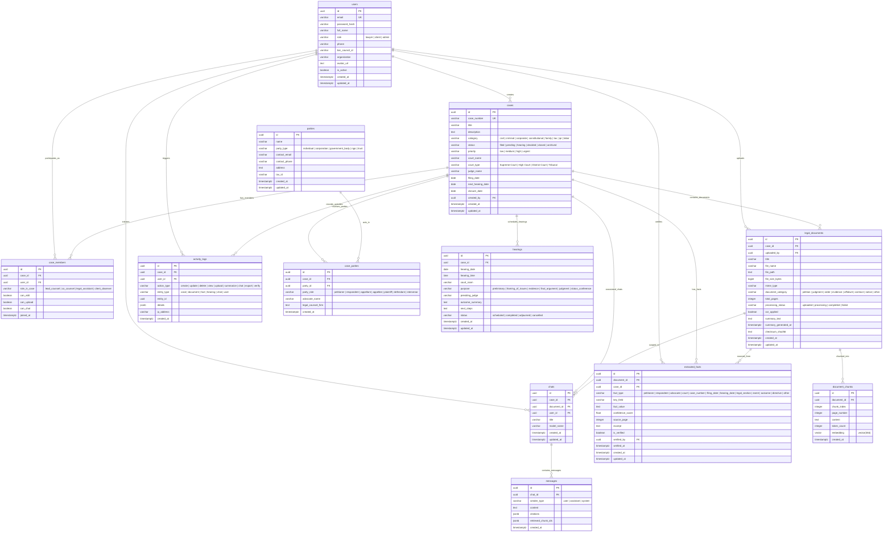

# NyayaFlow – Database Architecture & Normalization Specification

This document details the relational database design for **NyayaFlow**, an AI-powered legal intelligence and case management platform. The schema has been systematically designed and evaluated against formal normalization principles from First Normal Form (1NF) through Fifth Normal Form (5NF) to guarantee data integrity, eliminate redundancy, and prevent update, insertion, and deletion anomalies.

---

## 1. Entity-Relationship (ER) Diagram



---

## 2. Table Descriptions & Cardinality Relationships

### 2.1 Table Inventory

| Table Name | Description | Cardinality Relationships |
| :--- | :--- | :--- |
| **`users`** | Authentication credentials, profile, professional qualifications (Bar Council ID), system role (`lawyer`, `client`, `admin`). | $1:N$ with `cases` (as creator), `case_members`, `legal_documents`, `chats`, `activity_logs`, `extracted_facts` (verifier). |
| **`cases`** | Primary legal matter container. Tracks case number, category, judicial forum, priority, and lifecycle status. | $1:N$ with `case_members`, `case_parties`, `legal_documents`, `hearings`, `chats`, `extracted_facts`, `activity_logs`. $N:1$ with `users`. |
| **`case_members`** | Junction entity managing access control and specific permissions (`can_edit`, `can_upload`, `can_chat`) for case collaborators. | $M:N$ junction between `cases` and `users`. |
| **`parties`** | Independent entity registry representing persons, corporate bodies, or government agencies appearing before courts. | $1:N$ with `case_parties`. |
| **`case_parties`** | Junction entity specifying party representation (e.g. Petitioner vs Respondent) and retained external counsel per case. | $M:N$ junction between `cases` and `parties`. |
| **`legal_documents`** | Encapsulates PDF files, metadata, cryptographic hash (`checksum_sha256`), categorization, page counts, and AI processing state. | $N:1$ with `cases` and `users`. $1:N$ with `document_chunks`, `extracted_facts`, `chats`. |
| **`document_chunks`** | Semantic text segments extracted from documents with page references and 384-dimensional dense vector embeddings. | $N:1$ with `legal_documents`. |
| **`extracted_facts`** | Atomic legal facts extracted via heuristic NLP and LLM parsing with page citations and manual lawyer verification status. | $N:1$ with `legal_documents`, `cases`, and `users` (as verifier). |
| **`chats`** | Persistent AI conversation sessions scoped to an entire case or anchored to a specific legal document. | $N:1$ with `cases`, `legal_documents` (optional), `users`. $1:N$ with `messages`. |
| **`messages`** | Individual conversational turns preserving prompt queries, grounded answers, chunk citations, and confidence scores. | $N:1$ with `chats`. |
| **`hearings`** | Judicial calendar of upcoming and past hearings, including courtroom, purpose, presiding judge, and adjournments. | $N:1$ with `cases`. |
| **`activity_logs`** | Append-only audit trail capturing user and system actions for compliance, observability, and dashboard activity feeds. | $N:1$ with `users` and `cases` (optional). |

---

## 3. Candidate Keys and Functional Dependencies (FDs)

### 3.1 Functional Dependencies per Table

#### `users`
- **Candidate Keys**: $\{ \text{id} \}$, $\{ \text{email} \}$
- **Functional Dependencies**:
  - $\text{id} \rightarrow \text{email, password\_hash, full\_name, role, phone, bar\_council\_id, organization, avatar\_url, is\_active, created\_at, updated\_at}$
  - $\text{email} \rightarrow \text{id, password\_hash, full\_name, role, phone, bar\_council\_id, organization, avatar\_url, is\_active, created\_at, updated\_at}$

#### `cases`
- **Candidate Keys**: $\{ \text{id} \}$, $\{ \text{case\_number} \}$
- **Functional Dependencies**:
  - $\text{id} \rightarrow \text{case\_number, title, description, category, status, priority, court\_name, court\_type, judge\_name, filing\_date, next\_hearing\_date, closure\_date, created\_by, created\_at, updated\_at}$
  - $\text{case\_number} \rightarrow \text{id, title, description, category, status, priority, court\_name, court\_type, judge\_name, filing\_date, next\_hearing\_date, closure\_date, created\_by, created\_at, updated\_at}$

#### `case_members`
- **Candidate Keys**: $\{ \text{id} \}$, $\{ \text{case\_id, user\_id} \}$
- **Functional Dependencies**:
  - $\text{id} \rightarrow \text{case\_id, user\_id, role\_in\_case, can\_edit, can\_upload, can\_chat, joined\_at}$
  - $\{ \text{case\_id, user\_id} \} \rightarrow \text{id, role\_in\_case, can\_edit, can\_upload, can\_chat, joined\_at}$

#### `parties`
- **Candidate Keys**: $\{ \text{id} \}$
- **Functional Dependencies**:
  - $\text{id} \rightarrow \text{name, party\_type, contact\_email, contact\_phone, address, tax\_id, created\_at, updated\_at}$

#### `case_parties`
- **Candidate Keys**: $\{ \text{id} \}$, $\{ \text{case\_id, party\_id, party\_role} \}$
- **Functional Dependencies**:
  - $\text{id} \rightarrow \text{case\_id, party\_id, party\_role, advocate\_name, legal\_counsel\_firm, created\_at}$
  - $\{ \text{case\_id, party\_id, party\_role} \} \rightarrow \text{id, advocate\_name, legal\_counsel\_firm, created\_at}$

#### `legal_documents`
- **Candidate Keys**: $\{ \text{id} \}$, $\{ \text{case\_id, checksum\_sha256} \}$
- **Functional Dependencies**:
  - $\text{id} \rightarrow \text{case\_id, uploaded\_by, title, file\_name, file\_path, file\_size\_bytes, mime\_type, document\_category, total\_pages, processing\_status, ocr\_applied, summary\_text, summary\_generated\_at, checksum\_sha256, created\_at, updated\_at}$

#### `document_chunks`
- **Candidate Keys**: $\{ \text{id} \}$, $\{ \text{document\_id, chunk\_index} \}$
- **Functional Dependencies**:
  - $\text{id} \rightarrow \text{document\_id, chunk\_index, page\_number, content, token\_count, embedding, created\_at}$
  - $\{ \text{document\_id, chunk\_index} \} \rightarrow \text{id, page\_number, content, token\_count, embedding, created\_at}$

#### `extracted_facts`
- **Candidate Keys**: $\{ \text{id} \}$
- **Functional Dependencies**:
  - $\text{id} \rightarrow \text{document\_id, case\_id, fact\_type, key\_field, fact\_value, confidence\_score, source\_page, excerpt, is\_verified, verified\_by, verified\_at, created\_at, updated\_at}$

#### `chats`
- **Candidate Keys**: $\{ \text{id} \}$
- **Functional Dependencies**:
  - $\text{id} \rightarrow \text{case\_id, document\_id, user\_id, title, model\_name, created\_at, updated\_at}$

#### `messages`
- **Candidate Keys**: $\{ \text{id} \}$
- **Functional Dependencies**:
  - $\text{id} \rightarrow \text{chat\_id, sender\_type, content, citations, retrieved\_chunk\_ids, created\_at}$

#### `hearings`
- **Candidate Keys**: $\{ \text{id} \}$
- **Functional Dependencies**:
  - $\text{id} \rightarrow \text{case\_id, hearing\_date, hearing\_time, court\_room, purpose, presiding\_judge, outcome\_summary, next\_steps, status, created\_at, updated\_at}$

#### `activity_logs`
- **Candidate Keys**: $\{ \text{id} \}$
- **Functional Dependencies**:
  - $\text{id} \rightarrow \text{case\_id, user\_id, action\_type, entity\_type, entity\_id, details, ip\_address, created\_at}$

---

## 4. Normalization Analysis (1NF to 5NF)

### 4.1 First Normal Form (1NF)
**Criteria**: Each column contains atomic (indivisible) values, there are no repeating groups or multivalued columns, and each record is uniquely identifiable by a primary key.
- **Application in NyayaFlow**:
  - Rather than storing comma-separated strings of party names (e.g. `"Tata Sons, Cyrus Investments"`) or attorney rosters directly within the `cases` table, distinct entities are factored into the `parties` and `case_parties` relation.
  - Document text is not stored as an array of page chunks inside `legal_documents`; instead, each chunk is normalized into atomic rows in `document_chunks`.
  - Facts, hearing dates, and user citations are modeled as individual, atomic tuple entries.

### 4.2 Second Normal Form (2NF)
**Criteria**: The relation is in 1NF and every non-prime attribute is fully functionally dependent on the entire candidate key (no partial dependencies on a composite key).
- **Application in NyayaFlow**:
  - In `case_members`, the composite candidate key is $\{ \text{case\_id, user\_id} \}$. The attributes `role_in_case`, `can_edit`, `can_upload`, and `can_chat` describe the specific relationship between that user and that case. They do not depend solely on `case_id` or `user_id`.
  - In `case_parties`, the composite key $\{ \text{case\_id, party\_id, party\_role} \}$ determines `advocate_name` and `legal\_counsel\_firm`. A party's permanent name or address is stored in `parties`, preventing partial dependency on `party_id`.
  - In `document_chunks`, $\{ \text{document\_id, chunk\_index} \}$ determines `page_number`, `content`, and `embedding`.

### 4.3 Third Normal Form (3NF)
**Criteria**: The relation is in 2NF and there are no transitive dependencies between non-prime attributes ($X \rightarrow Y$ and $Y \rightarrow Z$ where $Z$ is not a candidate key).
- **Application in NyayaFlow**:
  - In an unnormalized design, one might store `judge_name`, `court_address`, or `lawyer_email` inside `cases`. If `case_id` $\rightarrow$ `lead_lawyer_id` $\rightarrow$ `lawyer_phone`, a transitive dependency exists. In NyayaFlow, all user contact attributes are isolated in `users`.
  - Party metadata (such as `party_type`, `contact_email`, `address`) is held strictly in `parties`, rather than in `case_parties` or `cases`.
  - `document_chunks` only points to `document_id`. Case metadata is referenced via the parent `legal_documents` relationship, eliminating duplicate case columns in chunk tables.

### 4.4 Boyce-Codd Normal Form (BCNF)
**Criteria**: A relation is in BCNF if for every non-trivial functional dependency $X \rightarrow Y$, $X$ is a superkey.
- **Application in NyayaFlow**:
  - Every single determinant in each table is either the surrogate primary key `id` or an alternate unique candidate key (e.g., `email` in `users`, `case_number` in `cases`, $\{ \text{case\_id, user\_id} \}$ in `case_members`).
  - There are no non-superkey determinants influencing any attributes. Thus, all 12 tables satisfy BCNF.

### 4.5 Fourth Normal Form (4NF)
**Criteria**: The relation is in BCNF and contains no non-trivial multivalued dependencies (MVDs: $X \twoheadrightarrow Y$).
- **Application in NyayaFlow**:
  - Consider a legal case that involves multiple independent sets of entities: multiple authorized lawyers, multiple opposing parties, and multiple upcoming hearings.
  - If represented in a single relation `case_relations(case_id, member_id, party_id, hearing_date)`, there would be independent multivalued dependencies:
    $$\text{case\_id} \twoheadrightarrow \text{member\_id} \quad \text{and} \quad \text{case\_id} \twoheadrightarrow \text{party\_id}$$
  - A Cartesian product of rows would be required to represent combinations, producing severe redundancy and update anomalies.
  - NyayaFlow isolates these independent multivalued facts into separate relations: `case_members`, `case_parties`, and `hearings`. Hence, 4NF is strictly satisfied.

### 4.6 Fifth Normal Form (5NF / Project-Join Normal Form)
**Criteria**: The relation is in 4NF and cannot be non-loss decomposed into smaller relations without changing the semantics (it has no join dependencies not implied by candidate keys).
- **Application in NyayaFlow**:
  - In `case_parties`, does a 3-way cyclic join dependency exist between $(\text{case}, \text{party})$, $(\text{party}, \text{advocate})$, and $(\text{case}, \text{advocate})$? In real-world litigation, an advocate is hired specifically for a particular party in the context of a particular case. The relationship is inherently a ternary relationship $\{ \text{case\_id, party\_id, party\_role} \} \rightarrow \text{advocate\_name}$ and cannot be reconstructed without loss from binary projections. The relation represents an irreducible semantic unit and does not contain artificial cross-product join dependencies.
  - NyayaFlow deliberately stops decomposition at genuine semantic boundaries, avoiding unnecessary join overhead while preserving 5NF compliance.

---

## 5. Anomaly Elimination Analysis

| Anomaly Type | Unnormalized Vulnerability (Scenario) | How NyayaFlow Schema Eliminates It |
| :--- | :--- | :--- |
| **Insertion Anomaly** | A law firm cannot register a new opposing party or corporate entity in the system until that party is formally involved in an active case. | `parties` is an independent entity. Parties can be created, profiled, and enriched prior to or independently of case association. |
| **Insertion Anomaly** | An authorized user cannot be provisioned without immediately assigning them to a case. | `users` is decoupled from cases. The junction `case_members` handles case enrollment independently. |
| **Update Anomaly** | If an attorney's bar registration or phone number changes, updating it across 50 individual case records could lead to inconsistent data if some rows fail to update. | Attorney metadata is stored in a single tuple in `users`. Updating the record updates the profile universally across all referenced cases. |
| **Update Anomaly** | If a document's processing status changes, updating chunks directly could result in partial updates. | Status is stored in `legal_documents.processing_status`. Chunks refer back to `document_id`. |
| **Deletion Anomaly** | Deleting a resolved case from the database accidentally deletes the entire biographical and contact record of the parties involved. | Deleting a row in `cases` cascades to `case_parties` junction entries, but preserves the underlying records in `parties`. |
| **Deletion Anomaly** | Removing an unverified fact erroneously deletes the document from which it was extracted. | `extracted_facts` references `document_id` via a foreign key with `ON DELETE CASCADE`. Removing a fact has no destructive effect on `legal_documents`. |

---

## 6. Referential Integrity & Constraints Specification

### 6.1 Foreign Key Cascade Rules
- **`cases.created_by` $\rightarrow$ `users.id`**: `ON DELETE SET NULL` (preserving case history if an admin account is purged).
- **`case_members.case_id` $\rightarrow$ `cases.id`**: `ON DELETE CASCADE` (purging membership when case is permanently removed).
- **`case_members.user_id` $\rightarrow$ `users.id`**: `ON DELETE CASCADE`.
- **`case_parties.case_id` $\rightarrow$ `cases.id`**: `ON DELETE CASCADE`.
- **`case_parties.party_id` $\rightarrow$ `parties.id`**: `ON DELETE RESTRICT` (preventing accidental deletion of parties with active litigation records).
- **`legal_documents.case_id` $\rightarrow$ `cases.id`**: `ON DELETE CASCADE`.
- **`document_chunks.document_id` $\rightarrow$ `legal_documents.id`**: `ON DELETE CASCADE` (deleting a document removes its vector embeddings).
- **`extracted_facts.document_id` $\rightarrow$ `legal_documents.id`**: `ON DELETE CASCADE`.
- **`extracted_facts.verified_by` $\rightarrow$ `users.id`**: `ON DELETE SET NULL`.
- **`chats.case_id` $\rightarrow$ `cases.id`**: `ON DELETE CASCADE`.
- **`messages.chat_id` $\rightarrow$ `chats.id`**: `ON DELETE CASCADE`.
- **`hearings.case_id` $\rightarrow$ `cases.id`**: `ON DELETE CASCADE`.
- **`activity_logs.user_id` $\rightarrow$ `users.id`**: `ON DELETE SET NULL`.
- **`activity_logs.case_id` $\rightarrow$ `cases.id`**: `ON DELETE CASCADE`.

### 6.2 Unique and Check Constraints
- `users`: `UNIQUE (email)`
- `cases`: `UNIQUE (case_number)`
- `case_members`: `UNIQUE (case_id, user_id)`
- `case_parties`: `UNIQUE (case_id, party_id, party_role)`
- `document_chunks`: `UNIQUE (document_id, chunk_index)`
- `cases.priority`: `CHECK (priority IN ('low', 'medium', 'high', 'urgent'))`
- `cases.status`: `CHECK (status IN ('filed', 'pending', 'hearing', 'decided', 'closed', 'archived'))`
- `users.role`: `CHECK (role IN ('lawyer', 'client', 'admin'))`
- `extracted_facts.confidence_score`: `CHECK (confidence_score >= 0.0 AND confidence_score <= 1.0)`

### 6.3 Vector Indexing Architecture
- Extension: `CREATE EXTENSION IF NOT EXISTS vector;`
- Dimension: 384 (matching `all-MiniLM-L6-v2`)
- Vector Distance Operator: Cosine distance (`<=>`)
- Index Type: HNSW (Hierarchical Navigable Small World)
  ```sql
  CREATE INDEX idx_document_chunks_embedding_hnsw 
  ON document_chunks 
  USING hnsw (embedding vector_cosine_ops)
  WITH (m = 16, ef_construction = 64);
  ```
- Rationale: HNSW provides sub-millisecond retrieval with high recall, superior to flat scanning or IVFFlat for sub-million vector production collections.


